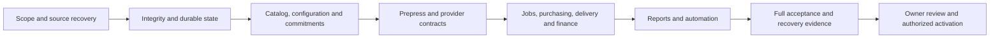

# Active V1 gap closure plan

Research and source audit completed **2026-11-07**, against application commit `57c58603aadcac8d2258d587121be12331bed10a` and the unchanged Master Platform Engineering Handoff v1.0. This is a concrete implementation plan; the application changes described here have not yet been made or deployed.

The plan covers **all 20 registered modules: 19 active V1 domains and the Coming Soon registry**. It maps the existing **205 inventory entries** (20 module outcomes, 86 required screens and 99 command contracts), plus **95 acceptance scenarios**: A01–A40, T01–T30 and inherited E01–E25. Common security, state, data-ownership, integration and UX invariants supplement those inventory entries. These counts establish scope coverage, not passing features.

The existing Next.js/TypeScript/PostgreSQL architecture remains. Development stays synthetic and isolated. PSRESTful is prohibited. Existing TwelveSpec production applications, databases, suppliers, customer data and domains remain excluded. AI design, 3D, automatic digitization, CAD, SaaS onboarding, general ledger, payroll, enterprise MRP and the other deferred features remain Coming Soon; their presence in a roadmap never enables them.

## What the audit established

| Category | Current evidence |
| --- | --- |
| Implemented | Separate storefront and Commerce OS; scoped domain services and RLS; synthetic catalog; saved carts/RFQs, quote/order snapshots, visual proofing, local imports and business workflows. Module-level details are in the coverage matrix. |
| Simulated | Supplier capabilities and synchronization, PO acknowledgments, payment/accounting references, tracking and outbound communications. Some required interfaces remain explicit activation blocks. |
| Verified integrations | Prior recorded Cloudflare deployment/Access/HTTPS browser checks and isolated local PostgreSQL tests. This research turn used public documentation and read-only GitHub metadata, not authenticated supplier tests. |
| Outstanding defects and incomplete logic | Premature unit rounding, dropped store/brand context, incorrect post-save variant binding, incomplete kit-to-order costs, inconsistent event names, hard-blocked production review, capped search/KPIs and incomplete native adapters. |
| Activation requirements | Database CA trust/persistence, private object storage and managed secrets, account-specific supplier/ASI access, legal/financial rules and explicit approval for new infrastructure or production activation. These are tracked separately from engineering work. |

The recorded baseline is **139 unit/security/PostgreSQL tests across 27 files**, with **nine earlier browser journeys** and a subsequent cap proof regression. Those are historical observed runs, not a claim that all 95 scenarios pass. This documentation-only audit does not re-run or promote that baseline to full V1 acceptance. Its new execution evidence is in [audit-reproductions.json](planning/audit-reproductions.json) and the plan integrity checks.

## Findings that set the order of work

Three isolated reproductions require no database or external account:

- Supplier unit cost `0.0250` at quantity `1,000` extends to **30.00**, instead of **25.00**, because `tierCost` rounds the unit first.
- `safeLines` drops `storeId`, `brandKitId` and kit context. A separate budget-check screen therefore cannot protect the actual cart, RFQ or accepted order.
- A manager reaches `PERMISSION_DENIED` at the marketing module gate even though its campaign approval handler permits managers.

Source review also confirms that changing designer color does not rebind an existing project; proof lookup can choose by a shared document hash; several real event names cannot be selected by automation; batch mockups use a generic rectangle; and production preflight/release is always blocked. A successful undecorated mock order cannot establish the decorated apparel/print workflow.

A read-only GitHub check found that the selected repository is **public**, contains only its initial `main` branch, and has **zero workflow runs**. The working implementation branch is local. Safe source publication and actual CI evidence are early delivery work; they must not be reported as already completed. Publishing the supplied handoff or changing repository visibility requires the appropriate repository/privacy authorization.

## Milestones and exit criteria

There are **40 work packages**, each with observed code, required changes, explicit completion checks, dependencies, planned tests and activation gates. [GAP_AUDIT.md](planning/GAP_AUDIT.md) is the engineering detail; [gap-backlog.json](planning/gap-backlog.json) is the editable status record.

| Milestone | Work packages | Deliverable and exit criterion |
| --- | --- | --- |
| M0 — Scope and recoverable delivery | GAP-001, GAP-037 | Correct traceability and publish an authorized reviewable branch/PR. A real CI run must identify the exact implementation commit. The audit/mapping portion is complete; GitHub delivery remains open. |
| M1 — Durability and integrity | GAP-002–010, GAP-035 | Durable database/assets/secrets, consistent permissions/events, correct variant/proof and money behavior, healthy cross-app links, observed restart/restore behavior. Local logic work continues while hosted access is pending. |
| M2 — Authoritative catalog and customer commitments | GAP-011–017, GAP-032–033 | One canonical identity pipeline; reversible imports; exact media/options/zones; paginated search; store and kit context preserved; issued agreements bind seller, art, pricing, credit and tax/freight assumptions. |
| M3 — Creative and configurable integrations | GAP-018–023 | A legitimate manual/method-specific production review path; consistent 2D rendering; direct per-service PromoStandards profiles; complete no-code setup and independent sync; licensed ASI adapter implementation when authorized schemas are available. |
| M4 — Operational and business completion | GAP-024–029, GAP-036 | Component/decorator/kit routing, approved PO requirements, fulfillment/returns/remakes, reconciled direct costs, CRM follow-through, consent-aware marketing and supported sandbox adapter contracts. |
| M5 — Decisions and automation | GAP-030–031 | Whole-dataset financial/operational KPIs, drill-down reports, safe exports, versioned rules and actual event-triggered effects with visible remediation. |
| M6 — Full verification | GAP-034, GAP-038–039 | All contracted screens and roles; security/migration/recovery checks; all 95 scenario assertions; measured scale and accessible browser journeys. Missing external evidence stays BLOCKED_EXTERNAL. |
| M7 — Owner acceptance and activation | GAP-040 | One consolidated owner demonstration and separate development/pilot/production decisions, with a concrete approved resource/deployment change set and rollback. No implicit live activation. |

Within M1, implement permission/command schemas and database constraints first, then close the reproduced pricing, variant/proof and event defects. Prepare storage and vault adapters at the same time; switching the hosted preview waits for trusted TLS, tested migration/restore and the applicable resource approval. Within M2, canonical identity and authoritative configuration precede kit and agreement integration. The detailed dependency graph governs individual work, rather than treating every row in a milestone as interchangeable.

## Business rules to make authoritative

1. **One configuration and artwork identity.** Every cart line, issued line, proof, render, job and PO references an immutable product/variant/method/zone/version snapshot. A generic document hash is insufficient to identify a proof.
2. **One source of monetary truth.** Retain supplier precision before quantity extension, select only eligible exact source evidence, apply versioned margin policy, and round explicitly. Unknown freight/tax/cost does not become a zero-cost assumption or paid-checkout promise.
3. **One program commitment lifecycle.** Store eligibility, catalog assignment, brand, deadline, seller, approvals and budget are rechecked at authoritative server transitions. Reserve/capture/release/refund are locked, referenced and idempotent; buyer-entered totals are advisory only.
4. **One kit agreement.** Preserve kit identity, component variants/ratios, packaging, assembly and freight in the quote and accepted order. Decomposition creates actual component requirements and a kitting operation, not unrelated cart lines.
5. **Independent production permission.** A customer approves appearance. An authorized prepress operator releases a specific scanned production derivative against an approved method profile. Missing evidence blocks dispatch; accepting a client-supplied `approved` flag is never the review process.
6. **Independent purchase requirements.** A blank supplier, decorator and packer can serve one customer line through separate approved requirements. Approval binds the submitted payload. A timeout after writing is reconciled before another write is permitted.
7. **One event contract.** Services, automation, worker processing and notifications share versioned event names and payloads, correlation, origin actor, lease state and replay rules. A directly invoked test helper does not establish that a real business event triggers the rule.
8. **Conserved quantities and references.** Shipments, returns, remakes, budget adjustments and financial references conserve line quantities and value. External settlement/ledger authority remains outside Commerce OS. General ledger and payroll remain deferred.
9. **Whole-dataset decisions.** Pagination limits never become KPI totals or partial financial exports. Search/facets operate in PostgreSQL against scoped, indexed public projections; public serializers use explicit allowed fields.
10. **Truthful capability evidence.** Mock success, documented support, authenticated sandbox response and live read/write permission remain separate. Supported known profiles are configured by an administrator; unknown proprietary protocols require an adapter, not a misleading success card.

## Architecture decisions for implementation

- Preserve both Next.js interfaces and the shared authorized domain packages; fix behavior incrementally with reviewed forward migrations.
- Use the approved Supabase development project with a restricted application identity and separate migration identity. Keep certificate/hostname verification enabled. Do not replace Better Auth incidentally or apply Supabase `auth.uid()` policies to unrelated application identities.
- Use a dedicated private object store behind the existing scoped asset endpoint. **R2 is the recommended fit for the present Cloudflare runtime**, subject to resource/permission/cost approval. The Linux container needs a Node-compatible store adapter with bucket-scoped credentials or a verified internal broker; a Workers binding is not automatically available inside Node.
- Prefer a scoped **Supabase Vault broker** for dynamic supplier credentials, subject to a verified ACL/extension design. Keep decrypted views unavailable to browser/database public roles. Bootstrap deployment secrets and user-configured supplier secrets have different lifecycles; do not give ordinary application setup account-wide secret-edit powers.
- Keep the PostgreSQL outbox/job architecture and make claims durable before introducing another queue service. Database transactions stay short around claims/results. External calls and rendering must not hold long-lived business locks.
- Keep preview/sandbox/live policies explicit. Enabling external database/object storage connectivity does not authorize production suppliers, payment processors or arbitrary egress. Verify the actual deployment's egress controls and retain application destination restrictions.
- Research on JDF, commercial PDF preflight, Stripe, Printful and EasyPost informs data boundaries and error semantics. It does not activate a vendor, require a machine-control adapter, or select an unapproved financial service.

The reasoning and primary documentation are in [RESEARCH_DECISIONS.md](planning/RESEARCH_DECISIONS.md), with [30 dated source records](planning/research-sources.json). Access limits are recorded explicitly: the full GWG sign/display download requires login, and one Intuit page rendered only an application shell. No undisclosed profile details are inferred from these pages. Exact account schemas, licensing, pricing/retention obligations and vendor production tolerances remain explicit external inputs.

## Acceptance and evidence

Each repaired workflow needs a positive path and the applicable invalid transition, wrong role, cross-scope reference, stale revision, missing evidence, concurrent command, duplicate/replay, timeout and rollback cases. UI checks assert the persisted record/event outcome. New tests must reproduce the business failure rather than mirror a function's implementation.

Run targeted tests during each change, then the full local suites and required CI checks at the milestone. Use `npm run check:spec` and `npm run check:plan` to prevent omissions. The [coverage matrix](planning/COVERAGE_MATRIX.md) and [machine-readable requirements map](planning/requirements-to-work.json) retain every module/screen/command and every A/T/E scenario. New test paths in the backlog are **planned**, not a claim that files or passing results already exist.

Scale acceptance uses a reproducible seeded dataset and records hardware, concurrency, p50/p95, duration, peak memory and cost assumptions. Initial engineering targets, **not measured results**, are warm catalog search p95 ≤750 ms over 100k variants at 20 concurrent readers, a 100-product preview ≤3 s and commit ≤10 s, and admission/progress/recovery of 500 asynchronous renders without a blocking browser request. Set a documented total-render time budget from the measured worker baseline before calling T29 passed; do not invent a throughput result.

Human review remains consolidated after the active workflows integrate: embroidered apparel, commercial print and a mixed-source event kit, including catalog setup, quote, proof, approved PO draft, delivery and profit closeout. Record clicks/time and open failures. Automated accessibility checks are supplemented by keyboard/focus and assistive-technology review.

A work package closes only with its code/migration, real test command, fixture, result, commit, environment and retained artifacts. Use PASS, FAIL, BLOCKED_EXTERNAL and COMING_SOON separately. Full active V1 is not complete while required scenarios or plug-and-play behavior remain unproved. Production readiness additionally requires the specific owner-approved activation.

## Owner involvement

Engineering decisions and local synthetic implementation proceed independently. No decision is requested by this planning document. The [activation-gate register](planning/gap-backlog.json) records only the specific inputs needed when implementation reaches them: the database CA, scoped storage/vault permissions or costs, supplier and ASI access/licensing, legal/financial/communication approval, repository confidentiality permissions and explicit deployment authorization.

Before requesting an infrastructure or launch approval, prepare the exact resource/permission diff, expected cost, completed local verification, migration/recovery and rollback evidence. Do not ask the owner to solve routine architecture or business-rule implementation choices, and do not silently waive an external requirement.
