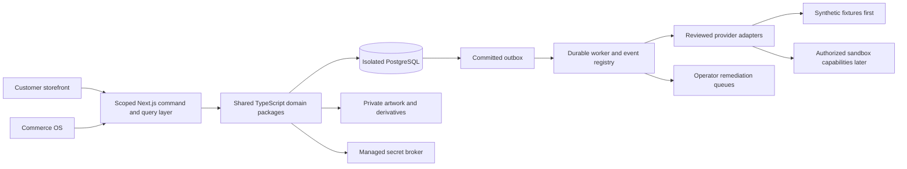

# TwelveSpec feature and workflow engineering blueprint

Research date: **November 6, 2026, America/Chicago**. Controlling specification: [Master Handoff v1](../../specification/master-v1/README.md). Implementation baseline: local commit `51a1011`, following application baseline `57c5860`. This is an original implementation design, not a claim that new features have been built or that competitors' private internals were inspected.

The purpose is to use the requested companies as sources of product and workflow ideas for TwelveSpec's own software. Supplier selection and commercial purchasing are secondary. No platform migration, subscription purchase, production access, supplier purchase or deployment is part of this research.

## What the combined product should do

TwelveSpec should provide a continuous journey from discovery to an approved, fulfillable order. A buyer can find a product, choose valid options, work on the same design that staff sees, request or accept an accurate quote, and follow individual items through delivery. Commerce OS should operate the same records: source data, price evidence, artwork versions, approvals, purchase requirements, job operations and financial references.

The strongest combination is an assisted design experience informed by Custom Ink, an accountable sales/proof process informed by 4imprint, program stores informed by OrderMyGear, print-specific file and option handling informed by PrintNow and trade printers, and explicit purchasing/fulfillment controls informed by Oracle's separate NetSuite and Fusion product families. These are design conclusions from the [company evidence](COMPANY_PROFILES.md), not performance rankings or a proposal to purchase those platforms.

The differentiator is continuity. A visual editor, a budget widget and a supplier catalog do not form a complete workflow if their identities disappear at checkout. Preserve the exact product, variant, design, program, kit, seller and cost evidence through every downstream record.

## Evidence and interpretation

The [source register](SOURCES.md) records 39 official vendor/standards sources, including access limitations. The [35 feature packs](FEATURE_PACKS.md) turn that evidence into original designs. Their record names, commands, event choices and tests are TwelveSpec proposals. They do not describe a vendor's database, algorithms or private APIs.

Public documentation establishes advertised or documented behavior. It does not establish TwelveSpec's account entitlement, API connectivity, supplier quality, negotiated price or legal permission to republish media. PCNA's main site and direct SinaLite pages returned 403; the SinaLite feature findings use identified official indexed excerpts. No access controls were bypassed. An expired PCNA promotion supplies no margin or revenue assumptions. GotPrint's published API terms establish that conditional access is described, not that a current contract or fee quote has been obtained. See [PCNA application](https://cloud.engage.pcna.com/account_application), [SinaLite integration options](https://sinalite.com/en_us/api-signup) and [GotPrint API terms](https://www.gotprint.com/company/terms/api.html).

Existing handoff requirements take precedence over competitive inspiration. For example, Imprint.com's conditional proof policy does not weaken TwelveSpec's approval gates, and 4imprint's published terms do not replace the handoff's prepaid/approved Net 15 policy. See [Imprint proof policy](https://imprint.com/help-center/will-i-get-a-proof-to-review-before-my-order-is-printed), [4imprint FAQ](https://www.4imprint.com/info/faq) and [TwelveSpec decisions](../../specification/master-v1/docs/00_SCOPE_AND_DECISIONS.md).

## Borrow the interaction, design the logic

| Product pattern | Original TwelveSpec behavior | Feature packs | What must remain explicit |
|---|---|---|---|
| Guided shopping and human assistance | Faceted catalog, saved shortlist, assigned inquiry and size matrix | F01, F02, F08, F34 | Public product data is separate from private source data |
| Shared designer | Customer/staff project, actual product geometry, immutable saves, private source files | F05, F06, F07, F31 | A 2D preview does not pass production preflight |
| Company/pop-up/redemption stores | Member eligibility, catalogs, brand controls, closing dates and allowances | F09–F12 | Company budgets, buyer payment and fund settlement are separate |
| Bulk and repeat ordering | Campaign quantity collection, quote revision, repriced reorder | F02, F11, F14, F15 | A prior order is a reference, not a new purchase authorization |
| Multi-source catalog | Canonical identity plus independently eligible supplier offers | F03, F16–F19, F29 | Each source and API capability has its own evidence and rights |
| Print MIS | Line-level jobs, material supply, decoration, assembly, QC and dispatch | F13, F20–F23, F31, F35 | Partial fulfillment and holds remain visible |
| Management control | Scoped authority, task queues, direct-profit reconciliation, durable events | F21, F24–F28, F32 | Approval, actual outcome and accounting reference are distinct facts |

This synthesis fits the existing two Next.js applications and shared TypeScript packages. Retain PostgreSQL as the business record authority, private object storage for artwork, managed secret references, and a durable worker/outbox. Keep the modular monolith. Competitive research does not justify splitting the product into independent services or embedding several commercial platforms as the core.

## The customer and operator journeys

### A. Apparel with a shared design

1. The customer selects a product and enters quantities by exact color/size variant. Product rules determine eligible methods and imprint locations.
2. The designer opens with that variant's actual 2D geometry. The customer adds licensed artwork/text, saves an immutable version and can resume it later.
3. Cart/RFQ stores configuration and design references, the requested arrival date and destination. Missing freight, decoration details or current prices keeps the request quote-only.
4. Sales reviews the request, confirms the source and landed cost, freezes an issued quote revision and identifies the legal seller and applicable terms.
5. The customer accepts an unexpired revision. The payment/approved-credit gate is evaluated independently.
6. A proof is generated from the exact product/variant/design/configuration tuple. Customer approval and method-specific prepress must both be valid before production authorization.
7. MIS creates supply and decoration requirements. Purchasing prepares an exact PO; an authorized operator approves its payload and submits through a verified operation.
8. Receiving, production, QC and shipment update item-level progress. Finance reconciles actual direct costs and customer/supplier references; a reorder creates a current draft.

**Critical regression:** save a clay cap design, change to another color and attempt to reuse the earlier proof. The system must bind the new configuration correctly and reject any mismatched proof. This closes known identity gaps; it is not satisfied by rendering a different image in the browser. F02, F05, F07, F14, F20 and F35 own this journey.

### B. Company store with a controlled allowance

1. A company/location member enters an eligible program, sees assigned products and uses the approved brand kit.
2. Cart/RFQ/quote retain the company, location, store, membership, budget and brand policy revisions.
3. The server computes the final reservable amount from the agreement under the program's freight/tax treatment. It never trusts a browser-supplied budget amount.
4. In one transaction, lock the budget, recheck eligibility/window/limit, reserve the commitment and attach it to the exact agreement. The same request key returns the same reservation.
5. A required manager decision binds its approval to that revision. Acceptance cannot swap price, seller, brand kit, catalog item or ship-to after approval.
6. Cancellation or expiry releases only the outstanding reservation, once. Replacing an agreement releases/replaces its commitment atomically.
7. Program close can propose reviewed batches. It does not automatically settle fundraiser funds or spend with a supplier.

**Critical regression:** two concurrent 60.00 commitments against 100.00 remaining budget. At most one succeeds. F09–F12 and F14 own this journey. A separate `validate_budget` demo without integration into actual acceptance is insufficient.

### C. Two-sided trade print plus a kit

1. A supported print family collects dimensions/units, stock, sides, quantity, finish and turnaround option. It identifies front/back and any specialty masks as explicit file roles.
2. A selected kit adds exact components, box/insert requirements, inbound destinations and assembly work. The complete kit cost includes packaging, labor and freight legs.
3. The accepted agreement retains the print specification, kit identity, bill of materials and file bindings. Revisions remain reconstructable.
4. MIS allocates independent print/supply jobs, receipt tasks and assembly dependencies. Artwork and financial holds are evaluated per affected job/requirement.
5. Proof timing, facility calendars, transit and assembly determine the proposed arrival date. A quoted rush production duration does not erase proof or transit time.
6. A complete-kit shipment waits for all required components and assembly QC. Any approved partial shipment records exact quantities and new freight implications.

**Critical regression:** flattening a bundle into ordinary cart lines must not remove packaging, assembly cost or kit completion dependencies. F04, F07, F13, F20, F22, F31 and F35 own this journey.

### D. Administrator connects a supported supplier

1. Select a registered provider profile and mock/sandbox environment; inspect supported operations and account/licensing requirements.
2. Save credentials through a server-side secret broker. Return an opaque handle and masked metadata only.
3. Test each permitted operation with a redacted result: product, media, inventory, pricing, PO, status, shipment and invoice are separate capabilities.
4. Map a sample to canonical products/variants/options. Resolve ambiguous identities and preview public content, cost changes and rights.
5. Set pricing policy, independent synchronization schedules and freshness limits. Preview the effects before activation.
6. Activate approved reads first. Transactional operations require their own verified schemas, permissions and spend authorization.
7. Review run history, row errors, expired evidence and retry state. Rollback only expected revisions and prevent rolled-back evidence from pricing new work.

**Critical regression:** a successful Product Data fixture must not label order submission or invoice retrieval as verified. Supported profiles can be configured without editing source; a completely unknown API still requires a reviewed adapter. F03, F16–F19 and F29 own this journey.

### E. Supplier submission times out

1. Purchase approval freezes the provider, exact requirements, quantities, amount, currency, agreement hash and payload hash.
2. Submit using a durable intent and stable key. Store the attempt before transmitting.
3. If the provider could have accepted the order before timeout, record `UNKNOWN_OUTCOME`, preserve correlation evidence and open a reconciliation task.
4. Query using a supported provider reference or reconcile manually with attributable evidence. Do not generate a new order simply because no response arrived.
5. Resume only from an established acknowledgment/rejection and a still-valid approval. A genuine retry uses the approved idempotency behavior of that provider.

**Critical regression:** a worker retry or browser double-click cannot create another purchase for an already allocated requirement. F19–F21, F26 and F28 own this journey.

## Logical architecture and authority



| Data authority | Owns | May reference |
|---|---|---|
| Foundation/kernel | Identity scope, grants, legal seller assignment, audit, command envelope | All domain record IDs |
| Catalog/configuration | Canonical identity, publication, product rules, exact configuration | Source offers and licensed media |
| Creative | Private assets, design revisions, proofs, prepress and production artifacts | Exact canonical/configuration revisions |
| Estimating/sales | Cost evidence, price policy, issued agreement, acceptance | Product/design/program/source snapshots |
| Stores/BYOB | Eligibility, budgets, campaign context, kit composition | Approved catalogs and commercial commitments |
| Orders/production/procurement | Job operations, dependencies, purchase requirements, approved supplier intent | Accepted agreement and manufacturing artifacts |
| Fulfillment | Actual receipts/QC, packages, shipped quantities, tracking, claims | Job and order quantities |
| Finance | Actual direct costs, invoice/payment references and reconciliation | External authoritative financial events |
| Workflow/analytics | Event delivery, rule execution and reproducible derived reports | Committed domain facts; never invents their outcomes |

The [logical field dictionary](DATA_MODEL.md) specifies 292 fields across 30 logical entities, without operational customer, account or credential values. It is a proposal, not an applied migration. Extend existing records where possible. Introduce new relational tables when the integrity of a relationship, ledger or transition cannot be enforced in JSON. Arrays representing foreign-key relationships become join tables in physical migrations.

### Shared command and event contract

Retain the existing `/api/platform` dispatch surface where appropriate. Normalize the *internal* envelope and provide aliases for current command names; the dotted feature-pack names are conceptual domain operations, not existing routes. Session-derived tenant, workspace and actor are authoritative. Proposed examples use synthetic IDs and do not call external services.

```json
{
  "module": "stores",
  "action": "reserve_budget",
  "input": {
    "agreementRevisionId": "synthetic-agreement-3",
    "expectedRevision": 3,
    "idempotencyKey": "synthetic-reservation-intent-1"
  }
}
```

The server loads the agreement, resolves company/store/membership, computes the amount, checks grants and writes the reservation, audit and outbox in one transaction. A client cannot add `approved: true`, another tenant ID or a lower amount to bypass the policy. Store approval should be a recorded decision by a qualified actor, not an unchecked request boolean.

```json
{
  "eventId": "synthetic-event-1",
  "type": "budget.reserved",
  "schemaVersion": 1,
  "tenantId": "synthetic-tenant",
  "workspaceId": "synthetic-workspace",
  "aggregateId": "synthetic-reservation",
  "aggregateRevision": 1,
  "correlationId": "synthetic-correlation",
  "causationId": "synthetic-command",
  "payload": {
    "agreementRevisionId": "synthetic-agreement-3",
    "reservationId": "synthetic-reservation",
    "amount": "60.00",
    "currency": "USD"
  }
}
```

Use a single typed event registry for emitted and subscribed names. Validate payload version on enqueue and consume. An idempotent consumer keys the actual effect by workspace, rule revision, event and effect identity. It does not guarantee exactly-once external behavior by assuming every supplier implements idempotency.

### Critical database integrity changes

- **Scope and identity:** composite foreign keys include tenant/workspace and, where applicable, company/product identity. An ID's existence alone is insufficient.
- **Proof binding:** type product/variant/configuration/design relationships; query by the complete tuple. Reuse by matching document hash with an `OR` condition cannot authorize another variant.
- **Commercial snapshots:** accepted/issued rows are append-only. Record seller, quantities, assumptions, tax treatment, terms and relevant source/asset revisions. Subsequent edits create a new revision.
- **Budget ledger:** use a locked balance plus immutable reservation/commit/release entries and unique scoped intent keys. Validate cancellation/expiry against the current reservation state.
- **Purchase allocation:** lock requirements, maintain quantity allocations to PO lines and enforce one active purchase allocation per authorized requirement slice. Split quantities are intentional rows, not duplicate requests.
- **Source eligibility:** a current offer state, valid evidence window, rights and mapping revision govern quote selection. The predicate excludes rolled-back data, even if a cached cost remains present.
- **Quantities:** receipts, accepted production, rejected/waste, shipment and return quantities reconcile. Do not represent them as a mutable order status alone.
- **Money:** preserve raw supplier precision and original currency; extend before rounding. Commercial amounts follow the handoff's decimal policy. The proposed higher-precision source evidence fields need migration review; they do not change existing issued commercial values.
- **Durability:** command effects and outbox entries commit together; audit records cannot be rewritten. Provider response bodies are bounded and redacted.

## Rules for useful calculations

**Pricing.** Extend each cost using its basis: per item × quantity, per setup × approved setup count, shipment × destination group, or kit × assembly quantity. Include known blank, decoration, setup, prepress, packaging, labor and freight components. A component explicitly not applicable is a reviewed zero; an unknown component remains null. Supplier unit `0.0250` × `1000` is `25.00`, not `30.00`. Apply target margin as `cost / (1 - target_margin)` and round the commercial result under policy. Handoff defaults are 40% target and 30% floor with approved exceptions; they are not market performance estimates.

**Delivery.** A promise depends on a validated configuration, approval readiness, payment/credit release, source/facility calendar, cutoff, production, inbound freight, assembly and outbound transit. Parallel jobs determine a join's earliest start using the latest required predecessor. Until these inputs are established, show a requested date or estimate with assumptions. Store timestamps as instants and display business dates in the program's timezone; this research uses America/Chicago. Do not turn vendor timezone abbreviations or marketing turnaround claims into universal TwelveSpec rules.

**Inventory.** Available stock is observed evidence with a timestamp and origin. It does not guarantee reservation or production capacity. A firm commitment may need a fresh read or source confirmation. For kits, capacity is limited by required component availability and qualified assembly capacity; do not promise all components simply because each has a catalog page.

**Actual profitability.** Freeze the estimate and compare to attributable actual cost lines, refunds, supplier credits and recorded owner time. Define treatment of freight recovery, transaction fees and remakes. Report direct gross profit and contribution according to explicit definitions; neither is automatically business net profit. Customer payment, processor payout and supplier charge remain separate reconciliation facts.

## Adaptation choices and tradeoffs

1. **Quote-first, with clearer estimates.** Guided configuration can feel fast while missing cost/art inputs safely route to review. Paid checkout activates only when all commercial and financial requirements are satisfied.
2. **One design model for customers and staff.** Reuse domain data and rendering contracts across the two interfaces; tailor permissions and tools. Avoid independent editors whose files cannot be reproduced downstream.
3. **Product families, not one universal options form.** Apparel, promotional decoration, flat print, signs and kits need different validated specifications. Reuse rule primitives and a common configuration envelope.
4. **Original domain core, adapter edges.** Shopify/BigCommerce are useful models or future channels. Printful/Printify and trade APIs are provider integrations. None must become the authority for TwelveSpec's entire catalog or agreement history.
5. **Manual work with explicit evidence is a valid V1 path.** Assisted sourcing and qualified manual prepress can be complete workflows. A forced blocked result or an unexplained success button is insufficient.
6. **Exact routing before alternatives.** Show source alternatives as reviewed proposals. Brand/material/geometry changes may alter the buyer's approval, not merely internal procurement convenience.
7. **Program purchasing before complex settlement.** Budgets, allowance reservations and closing dates are active V1. Complex fundraising settlement and autonomous purchasing remain reserved.
8. **Operational controls before ERP breadth.** Adopt approval, line-task and audit patterns. Full GL, payroll and enterprise MRP remain Coming Soon. NetSuite and Fusion are separate references, not a single required integration.

Current documentation matters: [Shopify's B2B plan matrix](https://help.shopify.com/en/manual/b2b/getting-started/plan-features) differs from older assumptions; [Printful v2](https://help.printful.com/hc/en-us/articles/50262214313873-What-should-I-know-about-Printful-s-API-v2) remains labeled Open Beta; [Fusion's 26D notes](https://docs.oracle.com/en/cloud/saas/readiness/scm/26d/order26d/26D-order-mgmt-wn-t78045.htm) remove specific planning features. Pin the behavior being adapted and the API operation being tested instead of copying an old broad feature list.

## Implementation waves in the existing repository

These waves refine the [existing gap plan](../GAP_CLOSURE_PLAN.md); they do not replace its dependencies, 205 inventory entries or 95 acceptance scenarios.

| Wave | Concrete result | Feature packs | Existing gap work |
|---|---|---|---|
| 0. Persistence and authority | Durable isolated data/artwork, managed secret boundary, scoped roles, typed relationships, event registry and recoverable source | F03, F09, F16, F26, F28, F32 | GAP-002–007, 014, 034–037 |
| 1. Trustworthy commercial spine | Correct precision and source eligibility; exact configuration/design/proof binding; immutable agreement and acceptance | F02, F04–F08, F14, F31 | GAP-009–010, 013, 017–019 |
| 2. Programs through the real cart | Company/location membership, budget reservations, campaign/allowance policy, kits and safe reorder | F09–F15 | GAP-011–012, 024 |
| 3. Usable integrations | Supported-profile wizard, staged CSV/XML, independent freshness, native services and licensed ASI interface | F03, F16–F19, F29 | GAP-014–016, 020–023, 036 |
| 4. Fulfillment and financial truth | Requirement-level sourcing, jobs/operations, PO approvals, uncertainty, QC, packages, claims and actual-cost references | F19–F24, F35 | GAP-018, 024–027, 036 |
| 5. Operability and acceptance | CRM follow-through, CMS rights/consent, replayable automation, full-data reporting, accessible contracted screens and evidence | F01, F25–F28, F30, F34 | GAP-008, 028–035, 038–040 |
| Reserved | Research retained, commands unavailable | F33 | Coming Soon registry; no activation |

Wave 1 begins with the known `tierCost` early-rounding defect, `safeLines` context loss, exact proof/variant checks and action-level authorization. These are more consequential than adding another attractive screen. Native integrations can develop against synthetic fixtures while these foundations are fixed; account-specific verification remains a separate milestone.

## Verification and activation

The generated feature packs contain **104 proposed behavioral tests**, each explicitly unexecuted. The [trace matrix](TRACEABILITY.md) maps every original module and acceptance scenario back to feature/gap work. Existing test files are references, not proof that a new feature passes. Research validation verifies internal coverage, references, artifact generation and calculations; it does not pass the application's cross-module acceptance suite.

For each implementation slice: test domain invariants and concurrent/duplicate commands, run PostgreSQL integration checks with scoped data, exercise customer and staff journeys in a browser, inspect public projections for leakage, then record commit-specific results. At the milestone, execute the original A01–A40, T01–T30 and E01–E25 requirements in full. Include scale, recovery, keyboard/mobile/error states and exact operation-level external evidence.

An authenticated supplier integration is **not verified by this research**. Obtain credentials, authorized schemas and relevant licensing only when the corresponding adapter is ready for account testing. Paid services, financial/legal commitments, source publication and deployment still require their applicable approval. No such action was performed here.

## Research follow-through

Use the workbook as a feature backlog and review aid. Use `research.json` and `data-model.json` as machine-readable inputs. Retain source IDs on implementation tickets and mark any later verified observation with account/environment/date/operation evidence. If a public source changes, revise the affected design rather than silently treating an old claim as current.

The packet provides an organized design basis for adapting these companies' useful patterns. Active V1 remains incomplete until the implemented workflows and original acceptance requirements pass. Coming Soon remains Coming Soon.
