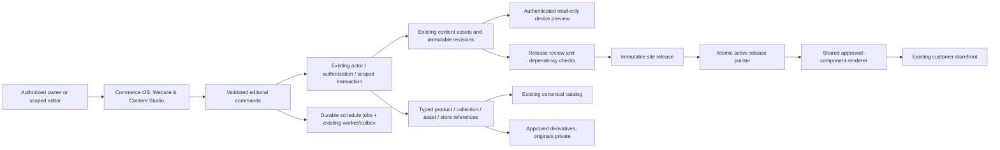

# Proposed architecture decision

**Status: recommended for review, not implemented.** No CMS package, paid service, new application or hosted resource was installed or configured.

## Decision

Build a bounded Website & Content Studio inside Commerce OS, under the existing Marketing domain. Reuse Better Auth, current actor/workspace resolution, the transaction/RLS kernel, marketing editorial records, canonical catalog, asset processing and the worker/outbox. Add a shared presentation-only component renderer consumed by the storefront and authenticated OS preview.

This is a new editing workspace, not a replacement for Commerce OS, another independent product database or an arbitrary HTML site builder. The original module registry stays at 20 entries; the studio is a child capability of Marketing/administration with scoped permissions.

## Build versus buy

| Option | Relevant strengths verified in primary docs | Integration and maintenance cost here | Recommendation |
| --- | --- | --- | --- |
| Native bounded studio | Reuses the application's existing auth, domain commands, PostgreSQL and deployment. Data/renderer contracts stay under TwelveSpec control. | We must implement and maintain editorial UX, immutable releases, scheduling, media governance and tests. Not zero engineering cost. | **Default:** lowest integration overhead for the existing system and this controlled component set. |
| Payload in the existing Next app | Current docs support Postgres, drafts/versions, live preview and installation into an existing Next application; core repository uses MIT. Its published version requirements encompass the current stack range. | Requires proof that Better Auth/session handling and scoped SQL coexist safely with Payload's admin/ORM. Requires custom canonical-product adapters and studio styling; advanced editor/workflow feature licensing must be checked separately. No integration test has been run. | Credible alternative if a short evaluation demonstrates lower total ownership effort. Do not scaffold over the current app. [Installation](https://payloadcms.com/docs/getting-started/installation), [live preview](https://payloadcms.com/docs/live-preview/overview), [core license](https://raw.githubusercontent.com/payloadcms/payload/main/LICENSE.md). |
| Directus | Database-oriented content administration, APIs, self-hosting and versioning ecosystem. | Another runtime/admin integration and permission model; must isolate its managed content from app-private tables. Current docs use MSCL, with free-core limits and paid/grant conditions, so old assumptions that all self-hosted use is free are insufficient. | Not the default. Legal/financial review before adoption. [Official self-hosting/licensing overview](https://directus.com/docs/self-hosting/overview). |
| Sanity | Managed content backend, live preview/visual editing, release tooling. | Another content store/API, identity/integration and plan/usage dependency. Current pricing distinguishes public-only Free datasets from private/public paid tiers; advanced release capabilities are plan-dependent. | Not justified by default for a single existing owner-managed platform. [Visual editing](https://www.sanity.io/docs/visual-editing/introduction-to-visual-editing), [pricing](https://www.sanity.io/pricing). |

The recommendation is an engineering judgment based on the inspected architecture. It is not a claim that a custom builder is universally cheaper than a CMS. Revisit it if maintaining the agreed component set becomes harder than a proven embedded CMS integration. No plan price or license eligibility is assumed for TwelveSpec.

## Composition

Candidate code locations after review: `packages/marketing/src/website/` for editorial commands, `packages/contracts/src/website/` for schemas/DTOs, a presentation-only shared renderer, and `apps/os/app/marketing/website/` for the workspace. The editor can reuse the current OS shell/auth rather than duplicate it. Public content resolution is added to the existing storefront route composition; product, configuration, cart, designer and account paths stay protected/reserved.

## Ownership boundaries

| Concern | System of record | What the studio may do |
| --- | --- | --- |
| Editorial pages, menu labels, themes, campaign copy | Versioned editorial documents | Create drafts, preview, review, publish, archive and restore. |
| Products, variants, taxonomy and curated membership | Existing catalog | Select published IDs; call authorized catalog commands for merchandising; deep-link to product curation. |
| Customer artwork/design/proofs | Existing Creative domain/private assets | Reference only an explicitly approved reusable derivative/template; never expose original customer artwork. |
| Production specifications | Existing configuration/MIS/production review | Display verified public facts; cannot edit manufacturing truth or release artwork. |
| Quotes, checkout, orders, payments and fulfillment | Existing commerce/sales/finance/operations | Route customers to the real workflow; no price, tax, approval or state overrides in page JSON. |
| Store branding, eligibility, budgets and windows | Existing stores + site-specific editorial documents | Theme/content within grants; program-policy edits remain store commands. |
| Campaign consent, audiences and sends | Existing Marketing/CRM | Link landing content and reusable approved assets; no automatic sends on page publication. |

## Publication and rollback

1. Saving a draft checks the actor/resource permission, schema, references and expected row revision. It appends an immutable content revision. The public release remains unchanged.
2. Preview renders that exact draft revision using the same component registry as the customer site. Desktop/tablet/mobile change only the viewport, not the underlying business data.
3. Review assembles a release from the active manifest plus explicitly selected approved changes. It does not collect every unrelated draft in the workspace.
4. Validation checks routes, required content, component versions, reference scope, publication/media rights, accessibility constraints and commercial action eligibility.
5. One transaction writes the immutable release and changes the site's active release pointer. Audit/outbox records capture author, approver, reason and hashes. No deploy, Git commit or external email is part of routine content publication.
6. Public reads use one release manifest for page/header/footer/theme consistency. Canonical products are still resolved through current published projections and availability gates.
7. Page restore creates a draft from a selected old revision. Page rollback creates a new release from current content plus that page revision. Whole-site rollback is a separate owner action. Revalidate dependencies first; a revoked image or paused product must not be resurrected. Transactions and production documents are never rolled back by CMS actions.

## Preview and caching

Prefer an authenticated same-origin OS preview using the shared renderer. Preview endpoints are read-only, require current permissions, return private/no-store responses and noindex metadata, and expose no commerce mutation controls. Do not use an unexpiring public shared-secret preview URL. If a storefront-tab preview is later needed, use a short-lived, scoped, revocable preview credential with fixed audience and validated internal destination. Do not share Better Auth cookies across origins or accept arbitrary redirects.

Next.js Draft Mode is a framework facility, not authorization by itself. Its preview isolation/cache behavior must be combined with the resource checks above. [Draft Mode](https://nextjs.org/docs/app/guides/draft-mode).

Cache published content by immutable release ID. Read the active release pointer consistently and invalidate publication/revocation paths explicitly. Next.js 16 `revalidateTag(tag, 'max')` permits stale content; it is not an immediate revocation guarantee. Use the current documented APIs and an explicit freshness policy, and test across the two app processes/any CDN rather than assuming one process's cache is global. [Revalidation semantics](https://nextjs.org/docs/app/api-reference/functions/revalidateTag).

## Permissions and public data

- Owner can independently edit, review and publish within the workspace after validation. Routine edits do not require a second employee or developer.
- Marketing editors can edit assigned site documents and request review. Publishing, brand approval and navigation/global changes are separate capabilities.
- A manager gets publication rights only through an explicit supported grant; repair the current module-role mismatch.
- Store administrators edit only their granted organization sites; global brand/site edits require separate permission. Eligibility requires **active** membership on read, preview and asset paths.
- Designers can prepare assets/templates without automatically receiving website-publication authority. Catalog managers retain catalog ownership.
- Customers and anonymous visitors cannot read editorial drafts or studio APIs. Public pages receive an allowlisted published DTO; they do not receive raw `content_assets`, campaign audience records or staff metadata.
- Do not treat the current anonymous demo-customer fallback as proof of organization membership. The published-only repository and its database reader/RLS policy must be proven in Phase 1 against the existing Better Auth/`ts_runtime` model.

## Storage and scheduling dependencies

Use the already-approved isolated PostgreSQL environment and a provider-neutral asset-storage interface. The existing Supabase project is a candidate for durable development data/storage once verified TLS and access policies are resolved; no remote change was made during this audit. Keep originals/private client material in private storage, and deliver approved derivatives through scoped publication checks. Public buckets are not suitable for customer artwork. [Storage access controls](https://supabase.com/docs/guides/storage/security/access-control), [bucket privacy](https://supabase.com/docs/guides/storage/buckets/fundamentals).

Scheduled jobs need durable data and a reliable wake/execution mechanism. The current container can stop after inactivity, so a timestamp plus its local polling loop is insufficient. After review, choose and test an authorized development wake mechanism; any new infrastructure/cost requires the applicable approval. Do not enable a "scheduled" success state until that executor works. Late, stale or revoked jobs must fail visibly instead of publishing expired promotions silently.

## Non-goals and safeguards

No second product database, second login, raw-HTML/CSS authoring surface, supplier scraper, PSRESTful, new paid service, production deployment or activation of unfinished features. Existing Coming Soon modules remain disabled. The technical schema below is a proposal, not a migration applied to a database.
