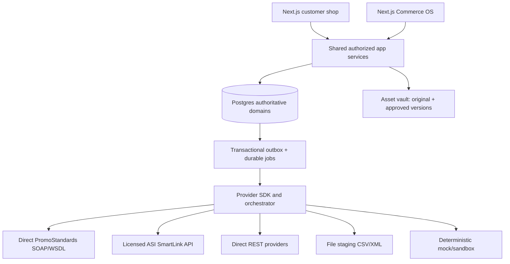

# End-to-end architecture and ownership

## Repo boundaries
`apps/shop`, `apps/os`, `apps/worker`, `packages/kernel`, `packages/catalog`, `packages/configuration`, `packages/creative`, `packages/pricing`, `packages/sales`, `packages/production`, `packages/fulfillment`, `packages/finance`, `packages/stores`, `packages/workflows`, `packages/providers`, `packages/contracts`, `packages/ui`, `supabase`, `tests`.

The UI must not directly access privileged database schemas or provider secrets. One verified server command owns each state transition. Every outbound command includes workspace, correlation ID, actor and idempotency key.

## Anti-corruption boundaries
- One **canonical product** has many supplier source products, variants and offers; supplier costs live only in private schema. Publication makes an explicit allowlisted public product projection.
- One **editable art project** has many immutable versions and placement uses; proof approval binds exact version hash, item and specification, not latest mutable preview.
- One **quote** has revisions; only an issued revision can be accepted. Acceptance creates immutable order snapshots with legal seller identity and commercial evidence.
- One **customer order** may have many **jobs**, **POs**, **fulfillment allocations**, **shipments** and **returns**. Job and PO are separate state machines.
- An **external payment processor or ledger** remains authoritative for transaction settlement; OS owns only reconciled references and operator workflow.

## Sync ownership and conflicts
Store upstream source payload hash, collection timestamp, provider ID, service/version, confidence, transformations, mapping version and lineage. On sync change, do not overwrite human-curated fields. Use explicit field ownership `SUPPLIER|TENANT|DERIVED` and generate merge review issues when values conflict.

## Event processing
Write `outbox_events` in same DB transaction as state changes. Worker claims lease, increments attempts, honors dedupe key, checks permitted transition, calls provider adapter, stores redacted result and commits state/event. Timeouts of write requests enter `UNKNOWN_OUTCOME` and force lookup/reconcile, not blind retry. Dead-letter queues are operator-visible.

## Plugin architecture
Each provider adapter declares separate capabilities, auth scheme, versions, scopes, rate limits, operations and error taxonomies. Registry allows connection activation, dry-run diagnostics and per-operation status. New supplier using a previously implemented protocol and known schema is configured, not coded. Novel proprietary APIs need a new adapter package.
