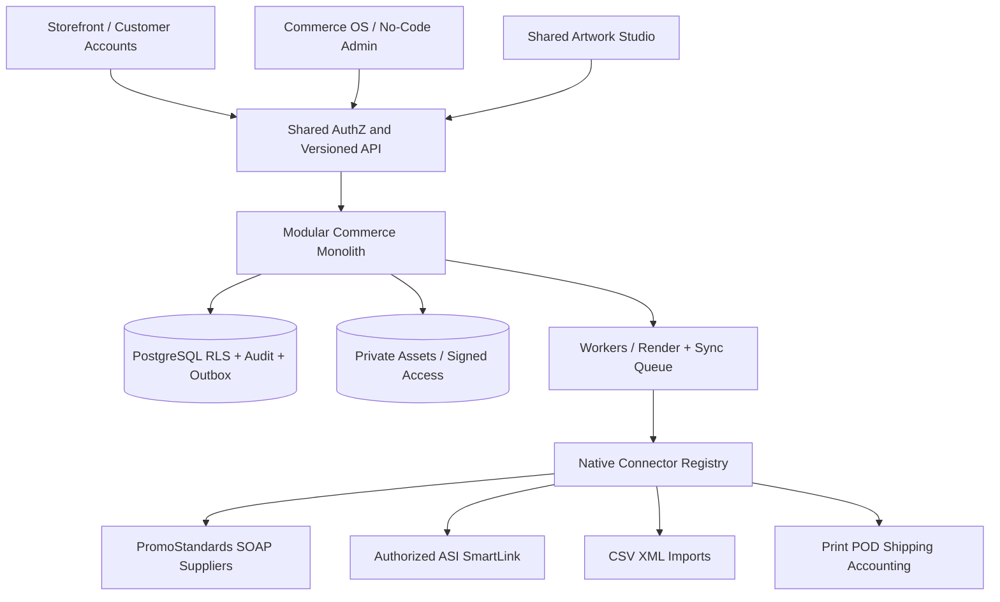

# Product and software architecture

## Mission and constraints

One canonical catalog and one transaction graph drive TwelveSpec Shop (customer-facing), TwelveSpec Create (customer/admin creative), and Commerce OS (owner/staff). Business goal: maximize repeatable gross profit per owner hour. Default UX is self-service + manage by exception. Customer-facing data must never disclose sourcing partners, internal costs, or private supplier identifiers.

## System diagram

## Product areas

- **Today:** exception inbox, owner's approval queue, gross profit per owner hour, task age, order aging and integration health.
- **Sales:** CRM organizations/persons, inquiry, opportunity, RFQ, estimates, quote versions, approvals, customer communications.
- **Catalog:** canonical products, supplier offers/variants, price breaks, decoration constraints, printable areas, collections, visual batch operations, import review, publishing.
- **Create:** customer and admin share immutable design versions; placement on 2D mockups, vector preparation, brand kits, proof approval; production outputs separate from previews.
- **Jobs:** jobs/operations, purchasing, outsource workflow, production QC, split shipments, remakes, returns.
- **Business:** finances/QBO references, stores/programs, marketing, workflows, people, integration settings, audit.

## Store program types

Retail catalog, B2B quote-first, corporate evergreen, school/fundraising campaign, event/pop-up, gift/redemption, and BYOB. Common data model: store + policy + catalog assignments + eligible buyers + brand library + discounts/budgets + fulfillment rules. Product release remains policy-gated.

## Technology and deployment

Target monorepo: `apps/shop` (Next.js), `apps/os` (Next.js), `packages/core` (business entities/rules), `packages/contracts` (OpenAPI/JSON schemas), `packages/connectors`, `packages/ui`, `packages/testing`, `supabase/migrations`. PostgreSQL with RLS and dedicated workers/outbox. Preview data isolated from all real ventures and original TwelveSpec OS repositories.

## Tenant and legal seller

Each record is `tenant_id` plus relevant `workspace_id`; workspace access is explicitly authorized. Legal seller snapshot copied onto issued quote and accepted order. No cross-venture sharing by default. Use separate user principals and grants for customer-facing access; don't expose DB-level supplier objects to anonymous browsing.

## Deliberately future modules

Advanced 3D/AR, automated embroidery digitizing, autonomous sourcing, manufacturing ERP, white-label SaaS and AI agent marketplace. Placeholders in OS with status `coming_soon`; no fake connected state or active purchase buttons.
