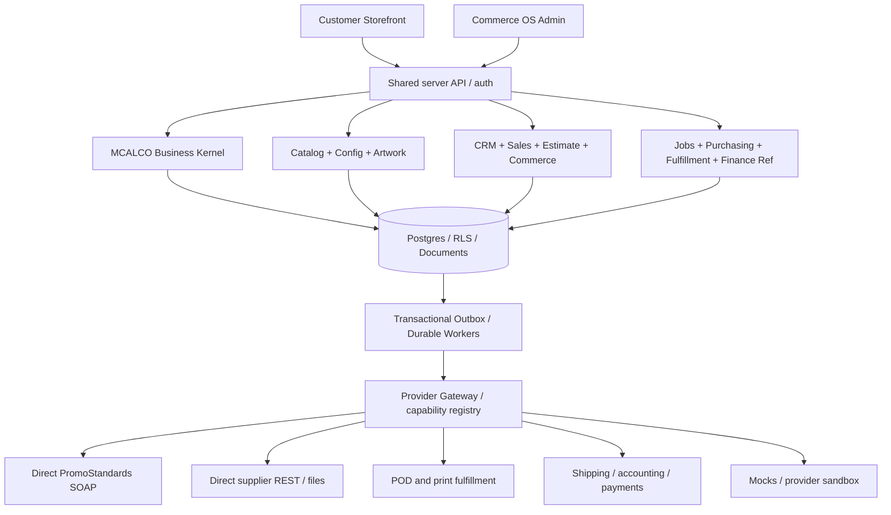
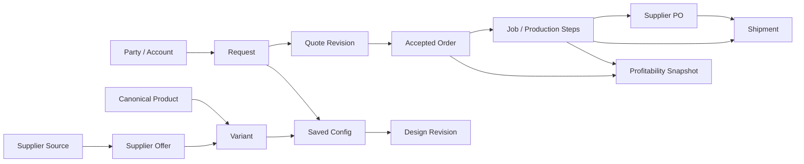

# TwelveSpec Platform — Product Architecture v1.0
**Date:** 2026-11-04 | **Status:** Proposed implementation contract; owner has not approved live execution | **Approach:** Greenfield, demo-first, one coordinated V1 build.

## 0. Product definition
**TwelveSpec** is a configurable business-to-business and consumer commerce platform combining (a) guided print/promo/apparel/custom-product purchasing, (b) a shared design/configuration system, and (c) an exception-first, whole-business operating system with lean print MIS. **MCALCO** owns the reusable business kernel; TwelveSpec is the first vertical application. Other ventures must be independently scoped and never see TwelveSpec's confidential facts by default.

**North star:** A customer expresses what they need; one configuration and one set of records carry the request from discovery to design, quote, commercial approval, payment, production, supplier purchasing, fulfillment, reconciliation, and reorder, with minimal owner intervention.

**Out of scope for active V1:** Full general ledger, payroll/HR/payroll tax, enterprise MRP, true CAD/manufacturing engineering, autonomous spending, verified automatic embroidery digitization, production-calibrated photorealistic 3D, comprehensive SaaS marketplace/billing. These have registered `COMING_SOON` modules, no misleading action buttons.

**Reference-only vendors:** Shopify, OnPrintShop, DecoNetwork, OrderMyGear, The Print Life, Supply Master, LogoMagic, Fulfill Engine, Order Desk, Cloudprinter, Printful, Scalable Press, Shippo, CI HUB, RushOrderTees, PSRESTful. Learn capabilities/patterns, do not copy proprietary source/UI and do not include PSRESTful in code/dependencies. PromoStandards is an independent open integration standard to implement natively.

## 1. Product experiences and interaction map
### Customer experience (one website, variable modes)
Global: search, mega menu, categories, brands (manufacturer only), industries/occasions, product compare, wishlist/recent, accessibility, mobile.
1. **Shop Products** — apparel/headwear, promo, print, signs/displays, trade shows/events, specialty/custom. Facets: real color swatches, sizes, brand, decoration, use case, MOQ, lead-time confidence, budget/price if verified, POD eligibility. Search defaults to canonical products not supplier duplicates; never hide alternative sourcing in operations.
2. **Product Detail** — gallery (product-specific, variant-specific), exact available sizes/colors, spec table, imprint area previews, quote/checkout eligibility, delivery disclosure and file requirements. Quantity per variant and tier breakdown.
3. **Configure & Create** — guided stepper: product/style → variants/quantities → print/decoration methods and locations → upload/brand kit → interactive canvas → review specifications → request quote or pay (eligibility-gated). Never indicate guaranteed production fidelity from a mockup.
4. **Projects / Quote Cart** — mixed items, custom requirements and service lines; estimate confidence and issue list; customer can save, collaborate (authorized roles), submit and revise.
5. **Company/School/Event Stores** — store program policies, approvals, budgets, allowances, close dates, fundraising allocation, collection assignments and branded assets. Unified store engine; configure optional paths, not hard-coded store types.
6. **BYOB** — curated build-your-own bundles; live incompatibility checks, kit components, split suppliers, packaging/assembly and project-based pricing; a bundle is a composed offering and not a copy of each SKU.
7. **Account** — proof approvals, order timeline, saved artwork, reorders, invoices/payment links when externally confirmed; requests for custom sourcing.

### Operator experience (five top-level destinations)
- **Today**: needs me, waiting, at risk, recently automated, pipeline value, jobs due, owner time, projected gross profit, actionable exceptions.
- **Sales**: CRM, leads/accounts, opportunity → RFQ → estimate → quote → approval/checkout → order, quotes and margin exception review.
- **Catalog**: canonical products, marketplace/source products, supplier offers, collections, variants, configuration families, bulk edit, data sync, product publish readiness, art/template library.
- **Jobs**: order workspace; proof, job ticket, production steps, purchasing, QC, shipments, returns/remakes, vendor bills, closeout. One order can create multiple jobs/POs/shipments.
- **Business**: finance references and margins, campaign/content, store programs, automation, people/roles, provider registry, reports, settings and Coming Soon directory.

**Staff principle:** a single job workspace with panels is better than opening 8 apps; retain full submodule routes for direct links/permissions. No organization-specific sensitive information in public data projections, SEO metadata, search indexes, logs, or asset links.

## 2. Architectural design
**Choose modular monolith**, one Postgres database per environment, event/outbox for async jobs, two separately deployable Next.js apps, one shared domain/API package. Avoid distributed microservices and second masters. Start with fresh isolated Supabase project and synthetic-only seed. Protect existing `twelvespec-os` populated data and deployments; use legacy repo only as carefully reviewed reference.



### Deployables and packages
```
apps/storefront          # public customer, companies and store programs
apps/commerce-os         # protected staff management
apps/worker              # durable outbox and renderer jobs (separately scaled when needed)
packages/contracts       # OpenAPI / Zod / generated TS client; no app logic
packages/business-kernel # tenant, workspace, legal entity, grants, audit
packages/catalog         # canonical identity, supplier offers, bulk + publish
packages/configuration   # typed option/rule AST and price eligibility
packages/creative        # design model, asset versions, placements and render queues
packages/sales           # request, quote revisions, order, payment state references
packages/mis             # jobs, route plans, supplier POs, QC, shipment
packages/finance         # cost lineage, external accounting references
packages/workflow        # events, rule AST, approvals, idempotency, work items
packages/providers       # interfaces + factory + capability manifests
packages/ui              # shared design tokens and primitives
supabase/migrations      # new initial schema and forward-only migrations
supabase/seed.sql        # synthetic seed only
tests/unit,contract,integration,e2e,security,performance
```
Use one package manager with pinned patched dependency versions and lockfile. Vendor-specific connectivity is behind ports/adapters and is never imported by customer UI code.

### Sync versus async
Synchronous: reads/search/config validation; draft quote preview only if all local evidence is fresh and deterministic. Async: catalog imports, image rendering, vectorization, bulk edit, provider quote refresh, supplier PO submission, label generation, external webhooks, notifications. Always show `PENDING`, `READY`, or `NEEDS_REVIEW`, never pretend pending work succeeded.

## 3. Product modules and feature registry
A module is a declarative object: `code, title, navigation, audience, owning_domain, status, capabilities[], permissions[], dependencies[], feature_flags[], integration_modes[], docs_url`.
Status: `ACTIVE_V1`, `SIMULATED_PROVIDER`, `COMING_SOON`, `DEPRECATED`. A `COMING_SOON` route must show scope/prerequisites with no working transaction commands, no purchasable offerings, and no false metrics. Enable only after tests and approval.

| Module | V1 functionality | Future placeholder |
|---|---|---|
| Core/governance | tenant, workspace, legal seller, roles, grants, audit, brand | External tenant onboarding, SaaS billing |
| Today | unified tasks, exceptions, KPIs/owner time | Predictive executive advisor |
| Sales/CRM | accounts, contacts, opportunities, RFQs, quote revisions | Predictive lead scoring, deep outbound AI |
| Catalog | canonical, variants, supplier offers, category tree, collections, bulk/CSV/publish | Autonomous enrichment and merchandising |
| Configurator | product-family rules, safe zones, dependent options | CAD/configure-to-engineer |
| Creative | shared canvas/editable designs, brand kits, admin templates, batch mockups, proof workflow | Automated digitizing, calibrated 3D, AI creative |
| Estimate/Quote | componentized costing, approved quote revisions, tax/shipping disclaimers | Optimization across many plant machines |
| Commerce | quote-first, eligible checkout sandbox, orders, account, reorder | Subscriptions / more channel connectors |
| Job MIS | ticket, work steps, proofs, QC, vendor routing, statuses | Real-time machine telemetry/MRP |
| Procurement | sourcing decisions, staged POs, vendor acknowledgements mock | Autonomous procurement |
| Fulfillment | packing/shipments, provider tracking, returns/remakes | Dynamic multi-warehouse optimizer |
| Finance | gross profit/job closeout, invoice/payment external refs | Full GL, payroll, advanced treasury |
| Stores | company, school, event, BYOB config, budgets and approvals | Complex fundraiser settlement automation |
| Marketing | content/calendar/library/campaign drafts | Autonomous omnichannel execution |
| Automations | safe WHEN/IF/THEN rules, simulation, audit/approvals | Freeform AI agents, marketplace |
| Integrations | direct PromoStandards mock/contract tests, REST/CSV, POD mocks | Additional licensed sources on demand |
| Reporting | KPI, profit/hour, margin variance, automation rate | Advanced BI/ML forecasts |

## 4. Data architecture: entities and ownership
**Base MCALCO v0.3** uses 34 logical entities in foundation, identity, relationships, offerings, commercial, documents, integrations/audit and operations. This contract is a *logical reference*, not DDL to be copied blindly. For TwelveSpec, extend with typed tables; keep core records reusable. All tables have scoped ownership and valid composite references.

### Kernel boundaries
- Governance: `tenants`, `portfolios`, `legal_entities`, `ventures`, `venture_legal_assignments`, `brands`, `workspaces`, `channels`, `user_profiles`, `tenant_memberships`, `workspace_memberships`, `resource_grants`.
- CRM: `parties`, `party_contacts`, `business_relationships`, `addresses`, `opportunities`.
- Offerings: `offerings`, `offering_versions`, `product_families`, `canonical_products`, `product_variants`, `category_nodes`, `collection_memberships`.
- Sales & commerce: `requests`, `request_lines`, `estimates`, `estimate_versions`, `estimate_lines`, `quotes`, `quote_revisions`, `quote_lines`, `orders`, `order_lines`, `payment_references`, `invoice_references`.
- Files/platform: `documents`, `document_versions`, `integration_connections`, `audit_events`, `outbox_events`, `idempotency_keys`, `work_items`.

### TwelveSpec vertical extension
| Domain | Logical records | Relationship/invariant |
|---|---|---|
| Supplier/source | `suppliers`, `supplier_service_capabilities`, `source_products`, `source_variants`, `source_price_breaks`, `source_inventory_observations`, `supplier_offers`, `source_mapping_reviews`, `sync_runs`, `sync_stage_records` | source has `(connection_id, supplier_product_id, supplier_variant_id)` unique, product may map many offers, source evidence immutable/stamped |
| Configuration | `option_definitions`, `option_groups`, `product_family_assignments`, `configuration_templates`, `configuration_template_versions`, `configuration_rules`, `saved_configurations` | published template/version immutable; typed rule tree; quantity/material constraints server-validated |
| Artwork | `brand_kits`, `brand_assets`, `design_projects`, `design_revisions`, `design_layers`, `placement_presets`, `imprint_zones`, `render_jobs`, `render_assets`, `proofs`, `proof_approvals`, `production_assets`, `preflight_results` | design revision immutable; source file never overwritten; customer and staff edit same project with different permissions; proof specifically approved |
| MIS | `jobs`, `job_lines`, `production_steps`, `work_centers`, `job_routes`, `job_assignments`, `qc_inspections`, `remakes` | order != job; 1 order many jobs; completed QC stays historized |
| Purchasing | `purchase_requirements`, `source_candidate_evaluations`, `purchase_orders`, `purchase_order_lines`, `provider_acknowledgements` | approved PO immutable; idempotent submission; supplier private |
| Fulfillment | `fulfillment_allocations`, `packages`, `shipments`, `tracking_events`, `returns` | shipments can split per order line/job and providers; never double-book label |
| Finance | `cost_components`, `landed_cost_snapshots`, `job_actual_costs`, `profitability_snapshots`, `external_finance_syncs` | costs unknown ≠ $0; decimal amounts; accepted pricing immutable |
| Store programs | `stores`, `store_programs`, `store_catalog_assignments`, `store_buyers`, `store_budgets`, `allowances`, `redemptions`, `fundraiser_campaigns`, `payout_obligations` | store is channel/program policy; scoped buyer visibility and allowance audit |
| Automation | `automation_rules`, `automation_rule_versions`, `automation_executions`, `approval_requests`, `notification_outbox`, `dead_letters` | explicit dry-run, dedupe, prevent loops, no automatic financial action |

Use composite `(tenant_id, workspace_id, id)` FK identity wherever applicable. Sensitive business tables are private; public storefront operates on **allowlisted published projections**, not direct source tables. Separate broad supplier public brand identity from private merchant/supplier relationship.

### Domain relationship summary


## 5. Non-negotiable rules and invariants
1. `organization/tenant` + `workspace` enforced by DB FK/RLS and server. Never rely on only client-controlled IDs; auth user metadata cannot grant rights.
2. Legal entity (`seller_of_record`) effective at quote/order issuance; frozen seller snapshot (name, address, legal terms); DBA/brand is separate. No seller history rewrite.
3. No fabricated supplier availability, decoration compatibility, delivery commitments, or cost. `UNKNOWN`, `STALE`, `UNSUPPORTED`, `VALID` are explicit.
4. One verified manufacturer/model identity can have many offers; automated deduplication only for exact identifiers/verified equivalent data; ambiguous matches go to review queue.
5. Published customer record is approved projection excluding suppliers, wholesale SKUs/costs, markup/margins, decorator/shipper identities, secret metadata and URLs. All public responses, SEO, assets, exports checked.
6. Curated customer copy, categories, imagery, artwork and price policy have precedence over upstream sync. Field-level provenance and change proposal; no silent overwrite.
7. `NUMERIC(18,4)` money + currency; no floating money. Landed cost = supplier units + setup + decoration + freight + packaging + relevant handling + expected spoilage + applicable fees. Taxes tracked separately; avoid silently including/excluding.
8. Gross margin = `(net_sales_revenue - direct_cost)/net_sales_revenue`; 40% target, 30% general floor; exceptions require approver and reason. Under no condition should missing cost become zero. Owner policy for first 2 orders prepaid; subsequent credit only with approved terms.
9. Quote estimate vs order-ready distinct. Discount, margin, tax, artwork, production and fulfillment checks determine whether checkout is enabled. Unknown freight -> quote-only.
10. Issued quote revisions, accepted orders, proofs, production file releases, financial references and POs are immutable/append-only versions with events; corrections create revisions or adjustments.
11. Supplier authorization separate from price approval, artwork approval, payment deposit and customer approval. PO submission requires all gates and explicit permission; mock mode never live calls.
12. All external writes (payment, supplier PO, label, accounting) require idempotency `(tenant,connection,environment,action,key)` and timeout reconciliation before retry. Use transactional outbox; process webhooks with signature, replay protection, dedupe, tolerance for out-of-order events.
13. Artwork preview is not production file. Print-specific preflight may require a licensed production tool or expert approval. Record physical dimensions, units, bleed, safety area, imprint zones, color method, version, output profile and acceptance.
14. No click-path can activate a `COMING_SOON` module, charge payment, or purchase product without feature flag, role policy, and backend gate.
15. Any feature that creates repeated owner work requires batch mode, defaults, automation, or explicit justified exception queue.

## 6. Configurator and estimating engine
### Product model
- `ProductFamily`: PROMO, APPAREL, PRINT, SIGNAGE, PACKAGING, KIT, CUSTOM_MANUFACTURED, SERVICE.
- Typed option: `choice`, `multi_choice`, `color`, `quantity`, `dimension`, `material`, `file`, `location`, `text`, `boolean`; units/validation/source ownership.
- Rule expressions: versioned typed JSON AST (`all`, `any`, `not`, comparison, membership, range, quantity tiers, variant availability); no arbitrary user JS/SQL from admin rules.
- Result: `valid_configuration`, `required_inputs`, `compatible_methods`, `decoration_zones`, `price_components`, `production_constraints`, `readiness_state`, and explainable trace.
- Product data and rules version pinned to issued quote; edits to current SKU do not rewrite prior transaction.

### Pricing algorithm
1. Exact supplier offer + variant + quantity + lead time + decoration method candidate.
2. Validate supplier account/currency, MOQ, color/size and stock/turnaround, template version.
3. Calculate blank and all process-dependent costs; setup and shipping from validated sources or `UNKNOWN`.
4. Calculate sell price from margin policy, customer program/discount and manual exceptions; explicit rounding and quantity breaks.
5. Return `ESTIMATE_ONLY`, `REQUEST_QUOTE`, or `CHECKOUT_ELIGIBLE` with reason codes. Avoid implying all products can purchase instantly.
6. Freeze quote snapshot, expiry and source evidence once issued.

## 7. Creative engine: customer and admin share the same model
**Document data:** immutable originals + editable `design_revision` AST (layers, vector paths/text, linked assets, transform matrices, color swatches, imprint zones, product/variant/template reference, physical units, print method) + separate render outputs + separate proofs + separately approved production outputs.

**Admin flows:** define product-specific print/decorate zone once; create family template; assign it in bulk; attach brand kit; queue variant/color mockups asynchronously; check preview fidelity; publish only approved assets. Saved presets propagate only to compatible products and have dry-run impact summary.

**Customer flows:** choose allowed design template or brand asset; upload logo; restricted canvas; save draft; proof request; approval (permissioned and version-locked). For vector tracing/spot colors: label tracing result `DRAFT_VECTOR`, never press-ready without dimensional checks, color mapping, fonts and review. No unsupported Pantone equivalence claims.

**3D:** app route exists as `COMING_SOON` (later model-template contract, glTF units, texture presets, renderer plugin). Embroidery digitizing, AI image generation and advanced preflight likewise Coming Soon until approved provider + tests.

## 8. Supplier gateway and import administration
- Direct PromoStandards SOAP/WSDL with supplier-specific endpoint/version/credentials. Directory REST service is discovery only, not universal catalog data.
- Adapter capability slots: PRODUCT_DATA, MEDIA, INVENTORY, PRICE_CONFIG, ORDER_SUBMIT, ORDER_STATUS, SHIP_NOTICE, INVOICE, WEBHOOK. Each slot has support/version/test evidence/freshness.
- Additional adapters: licensed SAGE/ASI discovery (license-gated), supplier REST/SFTP/CSV, Printful/Cloudprinter/Scalable Press sandbox mocks, Shippo, QuickBooks sandbox. PSRESTful excluded entirely.
- Pipeline: discover → fetch → raw immutable source evidence → parse/validate → stage → exact identity match → merge candidate/review → offer observation → delta analysis → publish approval. Import never publishes by default; field override and license rights respected.
- Products/suppliers can be listed in internal marketplace even when not published; supplier offer changes and `UNKNOWN` source state reflected in Today's exception queue. Bulk actions must preview affected counts and support reversible operator changes when not already used in immutable business transactions.

## 9. Job and fulfillment orchestration
One customer order can create multiple production jobs and purchase orders. One job may use multiple suppliers, decorators, carriers and split shipments. Routing decision factors: exact variant, material, decoration, MOQ, lead time, actual landed cost, supplier service availability, return/cancellation and capacity. Routing produces a versioned plan + candidate rejection reasons; significant changes require approval.

Job lifecycle: `NEW → PLANNING → WAITING_ARTWORK → PROOF_PENDING → READY → PURCHASING → IN_PRODUCTION → QC → SHIPPING → DELIVERED → CLOSEOUT → CLOSED`. Separate state machines for proof, PO, payment, shipment, inventory and claim. No magic single "order status" flag.

Kitting/BYOB: component-level stock/quantity constraints, kit packaging, assembly steps, batch split, shared shipping allocation. For outsourced print, supplier supplies tracking; do not buy own label. For in-house shipment, label via Shippo adapter only after eligibility.

## 10. CRM, marketing, finance and reporting
CRM: customer account hierarchy, contacts, opportunities, notes, activity, consent preferences, account pricing and authorized approval people; opportunities and projects link to jobs. Marketing: campaign/content assets, drafts, audience segmentation, tasks and measured attribution; no automatic cold outreach or mass-send without separate approval. Finance: payment and invoice references from authoritative external providers, costs by job component, estimated vs actual gross profit, credit/terms controls, cash exposure, owner hours and profit/hour metrics. Roles: owner, sales, estimator, creative, production, purchasing, finance, store manager, customer buyer/approver; each receives explicit capabilities.

## 11. Workflow automation
Visual `WHEN event` → `IF condition tree` → `THEN action` builder. Rule state `DRAFT/TESTING/ACTIVE/DISABLED`. Every rule has `version, owner, audience, allowed_action, dependencies, dry_run, approval_requirement, throttle, correlation, max_depth`, preview output and decision trace. Outbound customer messages are drafts by default; spend/send/publish require explicit release gates. Detect duplicate firing, cycles and conflicting rules.

Examples: supplier stock stale → exception; approved proof + payment confirmed → draft purchase authorization; shipped → customer notification draft; upcoming ship-date risk → Today alert; budget exceeded → store manager approval. Manage recurring failures by exception with snooze/escalation rules.

## 12. Security, operating cost and launch safety
- Database RLS with cross-tenant negative tests; least privilege staff roles and resource-scoped grants; account admins cannot see arbitrary tenant cost data.
- Secrets in provider vault, no public env or logs. API-facing JSON and image paths scanned for supplier disclosures and customer sensitive content; signed URLs expire.
- Snapshot source licensing, copyright and generated artwork rights; no large product-feed caching unless licensed.
- Separate public site from preview, brand assets private until approved. Data retention, audit and consent policies documented.
- Rate limiting, pagination and async backpressure for large catalogs and mockup jobs; 100k variants load-tested.
- Track real cloud usage (search/index storage, large images, background processing, provider API quotas, Vercel/Supabase capacity) before enabling high-volume import.
- CI gates: dependency audit (do not copy vulnerable original Next.js lockfile), lint, typecheck, unit, DB pgTAP/RLS, contract tests, API integration, E2E browser, performance smoke.

## 13. Greenfield development contract
Implement **full ACTIVE_V1 scope in one cohesive build**, with parallel code modules sharing stable contracts, technical tests during development, and one consolidated owner acceptance only after integrated build. First engineering checkpoint must be browsable local/dev preview using synthetic data (not a promised production release). Provider adapters use deterministic mocks and may be upgraded to sandbox only with credentials. No legacy migrations or populated production DB copies. No live emails, supplier purchase orders, payment charges, real customer accounts or DNS changes. Flag external-provider and legal activation dependencies in `OPEN_DECISIONS.md` and interview owner only for those.

**Acceptance summary:** (i) simulated complex hat+brochure+tent customer quote/order, (ii) editable artwork preserved through admin proof, (iii) spreadsheet-like catalog management, (iv) native PromoStandards test fixture, (v) split purchasing/fulfillment/job closeout, (vi) store permissions/budget, (vii) cross-tenant security, (viii) visibly disabled Coming Soon modules, (ix) no public supplier leakage, (x) verified reproducible clean installation and test evidence.

## 14. Design choices to validate in implementation
- Choose exact TS canvas/editor and SVG/PDF libraries after benchmark; no guarantees about raster-to-vector production quality.
- SAGE vs ASI licensing only if optional feed is activated, independent of direct PromoStandards.
- Choice of payment processor, tax engine, carrier accounts, GL implementation and email sender requires explicit real-world approvals.
- Make `apps/worker` optional deployment at low scale but a logical package now; use durable job processing before asynchronous provider operations.
- Existing MCALCO Phase 2 v0.3 architecture is a planning draft; its physical table names must not be treated as a verified migration contract.

## 15. Reference links (official / primary)
- PromoStandards directory API: https://promostandards.org/standards-services-api/
- S&S real multi-service/version endpoints: https://promostandards.ssactivewear.com/
- Supabase DB/RLS testing: https://supabase.com/docs/guides/local-development/testing/overview
- Supabase RLS: https://supabase.com/docs/guides/database/postgres/row-level-security
- Supabase branching: https://supabase.com/docs/guides/deployment/branching
- Vercel monorepo/Turborepo: https://vercel.com/templates/next.js/monorepo-turborepo
- Printful async mockup reference: https://developers.printful.com/docs/v2-preview/
- Prior research document: `TwelveSpec_Reverse_Engineering_Blueprint_v1.md` (companion reference)
